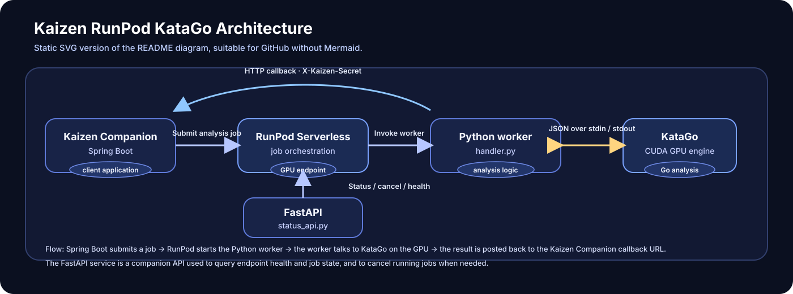

# ⛩️ Kaizen — RunPod KataGo Worker

**GPU-powered Go (Baduk) game analysis for [Kaizen Companion](https://github.com/eduardoSantiag0/kaizan-companion).**


This repository contains the **Python GPU worker** that runs [KataGo](https://github.com/lightvector/KataGo) on [RunPod Serverless](https://www.runpod.io/serverless-gpu). It receives a game-analysis request from Kaizen Companion, identifies critical moves, performs deeper analysis of the selected positions, and sends the results back to the Java/Spring Boot backend via HTTP callback.

It also includes a small **FastAPI proxy** for querying RunPod job status, cancellation, and endpoint health.

> **Scope:** This is the analysis worker, not the Telegram bot or job-orchestration backend. For the complete application and its RabbitMQ/CDC workflow, see [Kaizen Companion](https://github.com/eduardoSantiag0/kaizan-companion).

## ✨ Highlights

- **Two-pass analysis:** inexpensive screening of the whole game followed by deeper evaluation of selected positions.
- **Up to three critical positions:** chooses one move from each third of the game (opening, middlegame, endgame) based on the change in win rate.
- **Persistent KataGo subprocess:** communicates using KataGo's JSON analysis protocol over `stdin`/`stdout`, avoiding a new engine startup for every job.
- **Human-style analysis support:** passes the optional KataGo `humanSLProfile` override and loads both a strong and a human model.
- **Controlled engine access:** a Python lock serializes job access to the shared subprocess; an exited process is restarted for subsequent requests.
- **Backend callbacks:** submits completion/failure results with a shared-secret header (when configured) and bounded retry attempts.
- **Local testing:** Docker Compose starts a GPU worker with RunPod's local API emulation and a separate status API.

## 🧭 Architecture



The worker and the status API are **separate processes**. The Dockerfile starts `handler.py` by default. Docker Compose additionally starts `status_api.py` as its own service for local development.

### 🔎 Two-pass critical-move analysis

| Stage | Implementation | Search budget |
| --- | --- | --- |
| 1. Screen | Evaluate turns `0` through the final move, gathering win rates for each position | **20 visits per position** |
| 2. Select | Split the game into three equally sized move ranges and select the largest player-relative win-rate drop from each range | No additional search |
| 3. Refine | Re-evaluate the position **before and after** each selected move | **200 visits per position** |
| 4. Return | Package phase, move, turn, win-rate change, and detailed KataGo evaluations | — |

**Important:** “opening”, “middlegame”, and “endgame” are currently defined by **move-count thirds**, not by a board-aware game-phase classifier. Win rates come from KataGo's `rootInfo.winrate`; `config/analysis.cfg` sets `reportAnalysisWinratesAs = BLACK`, and the worker adjusts the comparison for the player who moved.

## 🧰 Tech stack

| Layer | Technologies |
| --- | --- |
| Engine | KataGo **v1.18.2**, built from source with CUDA backend |
| GPU runtime | NVIDIA CUDA **12.8.1**, cuDNN, Ubuntu **24.04** |
| Worker | Python 3, RunPod Python SDK, subprocess-based JSON analysis protocol |
| Operations API | FastAPI, Uvicorn, HTTPX |
| Packaging | Multi-stage Dockerfile, Docker Compose |
| Model inputs | `models/strong.bin.gz` and `models/human.bin.gz` |

## 📁 Repository structure

```text
kaizen-runpod-katago/
├── config/
│   └── analysis.cfg             # KataGo engine/search settings
├── models/
│   ├── strong.bin.gz            # Main KataGo network
│   └── human.bin.gz             # Human-style network
├── handler.py                   # RunPod handler + two-pass analysis + callbacks
├── events.py                    # Request DTOs and KataGo query serialization
├── status_api.py                # RunPod status/cancel/health proxy
├── requirements-status-api.txt  # FastAPI, Uvicorn and HTTPX
├── test_input.json              # Example analysis request
├── Dockerfile                   # CUDA-enabled multi-stage build
└── compose.yaml                 # Local GPU worker and status API
```

## 🚀 Run locally

### Requirements

- Docker Engine / Docker Desktop with Compose.
- An **NVIDIA GPU**, compatible drivers, and NVIDIA Container Toolkit (or Docker Desktop GPU support) for `gpus: all`.
- The model files referenced by the Dockerfile at `models/strong.bin.gz` and `models/human.bin.gz`.
- A compatible host/GPU environment for the image's CUDA 12.8.1 runtime.

### 1. Clone and configure

```bash
git clone https://github.com/eduardoSantiag0/kaizen-runpod-katago.git
cd kaizen-runpod-katago
```

Create a local `.env` file for Compose. Use your own values:

```dotenv
# Used as the X-Kaizen-Secret callback header (optional in code; recommended)
RUNPOD_HEADER_SECRET=replace-with-a-long-random-secret

# Needed when the status API talks to the real RunPod cloud API.
# The included Compose configuration instead uses RUNPOD_LOCAL_URL.
RUNPOD_API_KEY=
RUNPOD_ENDPOINT_ID=
```

**Security:** Do not commit `.env` or real credentials. The repository's `.gitignore` already ignores `.env`.

### 2. Start the services

```bash
docker compose up --build
```

| Service | Local URL | Purpose |
| --- | --- | --- |
| KataGo worker | `http://localhost:8970` | RunPod-compatible local API |
| Status API | `http://localhost:8971` | Proxy for job operations |
| Worker API docs | `http://localhost:8970/docs` | Local RunPod SDK API documentation |
| Status API docs | `http://localhost:8971/docs` | FastAPI OpenAPI documentation |

> The first build compiles KataGo from source and requires the model files. GPU access is required to execute the CUDA engine.

### 3. Submit a sample game

The repository provides [`test_input.json`](test_input.json), containing `analysisDTO` and `katagoQuery` under the RunPod `input` envelope.

```bash
curl -X POST http://localhost:8970/runsync \
  -H "Content-Type: application/json" \
  --data-binary @test_input.json
```

For an asynchronous local job, use `POST /run` instead and retain the **RunPod-generated job ID** returned by the API.

### 4. Query job status

The status proxy exposes:

| Method | Path | Behavior |
| --- | --- | --- |
| `GET` | `/status?correlationId=<RUNPOD_JOB_ID>` | Retrieves a job's status |
| `POST` | `/cancel` | Cancels a cloud RunPod job |
| `GET` | `/health` | Retrieves cloud RunPod endpoint health |

All three endpoints require the shared-secret header `X-Kaizen-Secret`, validated against `RUNPOD_HEADER_SECRET`.

Example:

```bash
curl "http://localhost:8971/status?correlationId=RUNPOD_JOB_ID" \
  -H "X-Kaizen-Secret: $RUNPOD_HEADER_SECRET"
```

The `correlationId` query parameter in this API is passed **directly as the RunPod job ID**; it is not automatically mapped from the application's own correlation ID.

**Local limitations:** `compose.yaml` sets `RUNPOD_LOCAL_URL=http://katago:8970`. In that mode, status lookup uses the local SDK and `/cancel` and `/health` deliberately return `501 Not Implemented`. To use those two endpoints, point the status API to the real RunPod cloud API and provide valid credentials.

## 📦 Request and result contract

The request body follows the structure used by the existing example:

```json
{
  "input": {
    "analysisDTO": {
      "correlationId": "kaizen-test-001",
      "chatId": 123456789
    },
    "katagoQuery": {
      "id": "kaizen-test-001",
      "boardXSize": 19,
      "boardYSize": 19,
      "rules": "japanese",
      "komi": 6.5,
      "moves": [["B", "Q16"], ["W", "D4"]],
      "includePolicy": true,
      "overridingSettings": {
        "humanSLProfile": "rank_12k_8k"
      }
    }
  }
}
```

`events.py` converts these fields to KataGo's expected schema; for example, incoming `initialStone` becomes `initialStones`, and `overridingSettings` becomes `overrideSettings` in the engine query. The handler overrides `analyzeTurns` and `maxVisits` to implement its two-pass pipeline.

On success, the worker builds the following logical result envelope:

```text
id: <katago-query-id>
output:
  chatId: <telegram-chat-id>
  correlationId: <application-correlation-id>
  status: COMPLETED
  output:
    gameId: <application-correlation-id>
    totalMoves: <number>
    criticalPoints:
      - phase, turn, player, move, winrateDrop, before, after
```

Each `before`/`after` field holds the corresponding KataGo analysis object. On processing failure, the callback reports `status: FAILED` and `output: null`, while the handler returns an error to RunPod. Invalid input and empty-game requests return errors directly.

## ☁️ Deploy to RunPod Serverless

1. Build a Linux/AMD64 Docker image from the supplied `Dockerfile` and publish it to a container registry accessible to RunPod.
2. Create a **custom Serverless endpoint** using that image and a compatible NVIDIA GPU.
3. Keep the default container command (`python3 -u handler.py`). The `--rp_serve_api` flags are for **local development**, not the Serverless endpoint.
4. Configure the backend callback URL and shared secret as endpoint environment variables.
5. Submit requests to RunPod's `/run` endpoint and retain the returned RunPod job ID for status/cancellation operations.

Example image build and push (replace the placeholder):

```bash
docker build --platform linux/amd64 -t YOUR_REGISTRY/kaizen-katago:latest .
docker push YOUR_REGISTRY/kaizen-katago:latest
```

The FastAPI status proxy is **not** started by the production Dockerfile's default command; deploy it separately if your architecture requires that interface.

### Environment variables

| Variable | Used by | Meaning |
| --- | --- | --- |
| `KAIZAN_CALLBACK_URL` | `handler.py` | HTTP URL that receives completed/failed analysis events. Defaults to a local development URL. |
| `RUNPOD_HEADER_SECRET` | `handler.py` | If set, sends the raw shared secret in `X-Kaizen-Secret`. |
| `RUNPOD_API_KEY` | `status_api.py` | Bearer token when calling RunPod cloud APIs. |
| `RUNPOD_ENDPOINT_ID` | `status_api.py` | Serverless endpoint ID for cloud status/cancel/health calls. |
| `RUNPOD_API_BASE_URL` | `status_api.py` | Optional cloud API base URL; defaults to `https://api.runpod.ai/v2`. |
| `RUNPOD_LOCAL_URL` | `status_api.py` | Optional local SDK API URL; bypasses cloud credentials and switches status lookup to local mode. |

**Compose caveat:** The current `compose.yaml` forwards `RUNPOD_HEADER_SECRET` to the worker, but **does not forward** `KAIZAN_CALLBACK_URL`. Changing that value in a local `.env` alone will therefore not change the worker's callback destination; update the Compose service environment if you need another URL.

## 🛡️ Reliability and security notes

- **Callbacks:** dispatched in a daemon thread, retried up to **3 attempts** on network errors and HTTP 5xx, with increasing backoff (`2s`, then `4s`) and a `10s` request timeout. HTTP 4xx errors are not retried.
- **Callback authentication:** `X-Kaizen-Secret` is a **shared-secret header, not an HMAC signature**. Set it on the worker and validate it on the receiving backend. Use HTTPS in production.
- **No durable callback queue:** a returned RunPod job result does not, by itself, guarantee that the asynchronous callback was delivered. Keep job-status reconciliation or another recovery path for production use.
- **Process isolation:** the worker uses a single persistent KataGo process guarded by a global lock. If that process exits, the handler restarts it and fails the interrupted request, rather than silently replaying it.
- **Protect the status API:** `/status`, `/cancel`, and `/health` all require the `X-Kaizen-Secret` header (validated against `RUNPOD_HEADER_SECRET`). It can still invoke cancellation with your RunPod API key, so keep that secret strong and also consider network restrictions or a trusted gateway in front of it.
- **GPU configuration:** tune `config/analysis.cfg` (threads, batch size, cache) against actual GPU memory and throughput rather than assuming one setting is optimal everywhere.

## 🧯 Troubleshooting

| Symptom | Check |
| --- | --- |
| Image build fails on `COPY models/...` | Both expected network files exist with their exact filenames. |
| KataGo fails to start | NVIDIA GPU/container runtime, CUDA compatibility, model paths, and `analysis.cfg`. |
| `docker compose up` cannot allocate GPU | NVIDIA Container Toolkit / Docker GPU access (`docker run --gpus all ...`). |
| Worker completes but backend is not notified | `KAIZAN_CALLBACK_URL`, container-to-host reachability, HTTPS, backend response, and `RUNPOD_HEADER_SECRET`. |
| Status API returns `500` in cloud mode | `RUNPOD_API_KEY` / `RUNPOD_ENDPOINT_ID` configuration. |
| `/cancel` or `/health` returns `501` | The status API is in local mode (`RUNPOD_LOCAL_URL` is set). |
| Status lookup returns `404` | Use the RunPod-generated **job ID**, not necessarily the Kaizen correlation ID. |

## 🔗 Related projects

- [Kaizen Companion](https://github.com/eduardoSantiag0/kaizan-companion) — Spring Boot orchestration, messaging, persistence, and Telegram delivery.
- [KataGo](https://github.com/lightvector/KataGo) — Go analysis engine.
- [RunPod documentation](https://docs.runpod.io/) — Serverless worker deployment and API reference.

---

Built as the GPU analysis component of **Kaizen Companion**.
